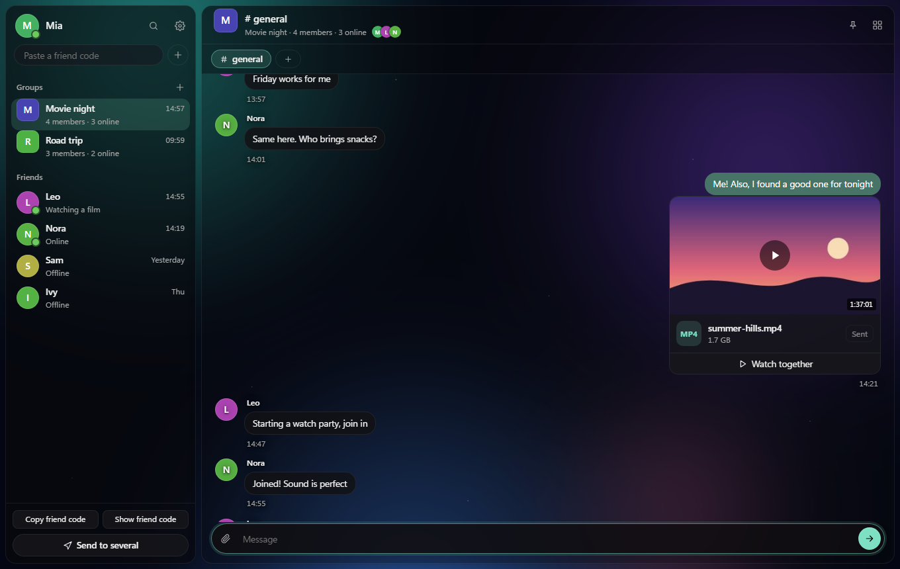
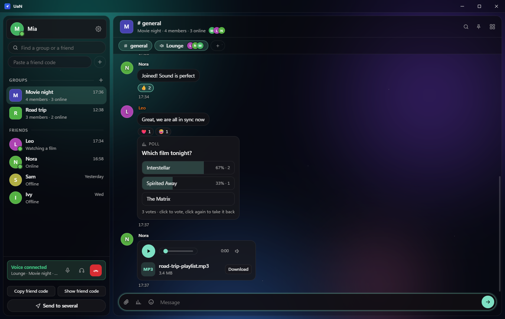
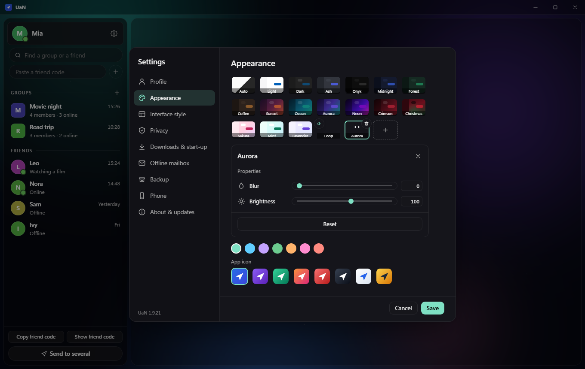
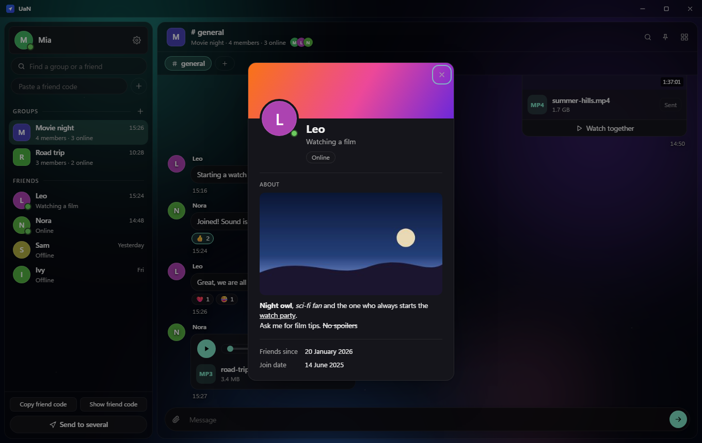
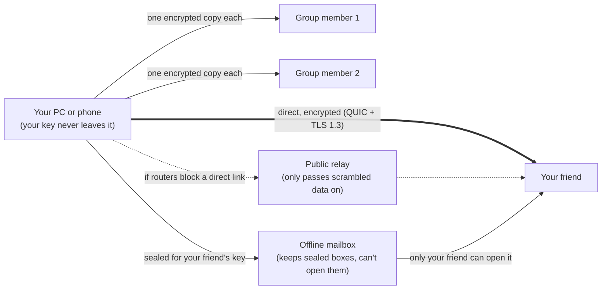

# UaN

**Chat, send files of any size and watch films together with your friends.** 
No server, no account: everything runs on your own PC.

[**Download**](../../releases/latest) &nbsp;·&nbsp; [How it works](#how-it-works) &nbsp;·&nbsp; [Features](docs/FEATURES.md)

 

 Screenshot from UaN 1.9.21, with invented demo people

 

## Why UaN

<table>
<tr>
<td width="33%" valign="top">

### Nothing in the middle
Messages and files go straight from one PC to another, end-to-end encrypted. There is no company server that stores your things, and no account to sign up for.

</td>
<td width="33%" valign="top">

### Files of any size
Drop a file or a whole folder into a chat, up to **4 TB**. Friends stream it from your PC, so films play without downloading first.

</td>
<td width="33%" valign="top">

### Watch together
Press play once and everyone sees the same moment. UaN keeps the party in sync, pauses for whoever falls behind, and has a chat and a playlist beside the film.

</td>
</tr>
</table>

## Download

Get the newest version from the **[Releases page](../../releases/latest)**. Everything UaN needs is included.

| System | File | How |
| --- | --- | --- |
| **Windows** | `UaN_…_x64-setup.exe` | Run it. If Windows says *unknown publisher*: *More info → Run anyway*. Allow it through the firewall on first start. |
| **Ubuntu, Mint, Debian, Pop!_OS** | `UaN_…_amd64.deb` | Double-click it and press *Install*, or `sudo apt install ./UaN_*_amd64.deb` |
| **Any other Linux** | `UaN_…_amd64.AppImage` | Allow executing (*Properties → Allow executing as program*), then double-click |
| **Android** | `UaN_…_android.apk` | Open it on the phone and allow installing from this source. Sign in with your PC's account (Settings → Phone on the PC). |

Already have UaN? You don't need to come back here: when a new version is out, a card appears in the app. One click and it
updates itself.

## Get started in a minute

1. **Pick a name.** That's the whole sign-up. Your identity is a key that stays on your PC.
2. **Swap friend codes.** Press *Copy friend code*, send it to a friend however you like, and paste theirs into *Paste a friend code*.
3. **Chat, drop files, press *Watch together*.** Make a group with **+** next to *Groups* if you want more than one person.

## Talk: voice channels and calls

<table>
<tr>
<td valign="top">

Make **voice channels** in a group (owners and co-owners: *New channel → Voice channel*). Click one to join: everyone
sees who is in it, with small pictures on the channel.

**Call a friend** with the phone button in a private chat. They get a card to answer or decline, and a notification.

The sound goes **straight between your devices**, with echo and noise removal. It's audio only, so it stays light.
Mute, deafen and leave from the bar at the bottom left. Soft sounds tell you when someone joins, leaves or calls,
and your theme keeps quiet while you talk.

</td>
<td width="56%" valign="top">

 Screenshot from UaN 1.9.45, with invented demo people

</td>
</tr>
</table>

## Make it yours

<table>
<tr>
<td width="56%" valign="top">

 Screenshot from UaN 1.9.21, with invented demo data

</td>
<td valign="top">

Seventeen built-in themes, or put your **own** behind the chat: a video, a picture or a small web page.

Double-click your theme to open its settings: **sound**, **volume**, **blur** and **brightness**, live, with a slider or a typed number.

</td>
</tr>
</table>

## Profiles

<table>
<tr>
<td valign="top">

Click anyone's picture or name to see their profile: status, **About**, since when you're friends and when they joined.

Write your About with **bold**, *italic*, <u>underline</u> and ~~strike~~, and add **one picture or GIF**. UaN shrinks it by itself.

Pick a **background** for your card: a ready-made one, any colour, or your own picture, right from your own profile.

</td>
<td width="56%" valign="top">

 Screenshot from UaN 1.9.21, with invented demo people

</td>
</tr>
</table>

## How your messages are protected

Everything is encrypted **on your device before it leaves**, and only the people it is meant for can open it. No server in the
middle can read it, not even the ones that only pass things along.

| What | How it travels | How it is encrypted | Who can read it |
| --- | --- | --- | --- |
| **A message to a friend** | Straight from your device to theirs | QUIC with **TLS 1.3**; both devices prove who they are with their **Ed25519** key | You and your friend |
| **When routers block a direct link** | Through a free public relay | The same TLS 1.3 encryption, end to end: the relay only forwards scrambled packets | You and your friend (not the relay) |
| **A group message** | To each member separately, over each one's own encrypted link | TLS 1.3 per member; there is no group server | The members of the group |
| **A locked channel** | Like a group message | Plus a second layer: **XSalsa20-Poly1305** with a key made from the channel's password (100 000 rounds of SHA-256) | Only members who know the password |
| **A friend is offline** | Waits in the mailbox until they come online, then it is deleted | Sealed for your friend's key before it leaves you: **X25519 + XSalsa20-Poly1305** | Only your friend (the mailbox sees sealed boxes) |
| **Files and films** | Streamed straight from your device | Over the same TLS 1.3 link; small files for offline friends are sealed like messages | The people in that chat |
| **Voice channels and calls** | Device to device | **DTLS-SRTP** (WebRTC); the call set-up goes over UaN's encrypted link | The people in the call |
| **Your identity** | Never travels | An **Ed25519** key made on your device; your friend code is only its public half | Nobody can pretend to be you |

**Good to know:** relays and the call helpers (STUN) can see *that* two devices connect, not what they say. The theme
workshop is public on purpose: themes you share there can be seen by everyone. On your own device, your messages are stored
so UaN can show them; *Settings → Privacy → Lock UaN with a password* keeps others out of the app.

## How it works

- **Friend codes, no accounts.** You add friends with a short code (`UAN-…`), hidden by default so it's safe while you stream your screen.
- **Anywhere in the world.** PCs find each other by their key and connect directly through routers when they can, otherwise through free public relays.
- **Your PC is the server.** Friends stream files straight from you, so UaN keeps running in the tray when you close the window. Quit it from the tray icon.
- **Offline friends.** Messages, previews and small files wait, encrypted, in a free mailbox until your friend comes online.
- **Plays everything.** If a film's format or sound can't play inside UaN, it opens in [VLC](https://www.videolan.org) by itself, still streamed, still in sync.

## And a lot more

Voice channels and calls &nbsp;·&nbsp; replies, edits, pins and @mentions (with a profile card on click) &nbsp;·&nbsp; channels with passwords &nbsp;·&nbsp; whole-folder sending with previews &nbsp;·&nbsp; photo grids &nbsp;·&nbsp; polls &nbsp;·&nbsp; search and gallery &nbsp;·&nbsp; subtitles &nbsp;·&nbsp; resume where you stopped &nbsp;·&nbsp; a theme workshop to share themes &nbsp;·&nbsp; lock UaN with a password &nbsp;·&nbsp; backups &nbsp;·&nbsp; co-owners &nbsp;·&nbsp; automatic downloads only where you allow them, never filling your disk &nbsp;·&nbsp; auto update &nbsp;·&nbsp; a phone app that signs in with your PC's account

Everything, in detail: **[docs/FEATURES.md](docs/FEATURES.md)**

## Good to know

- **Big files need both PCs on once.** The sender's PC must be on, with UaN running, until the friend has watched or downloaded the file. Automatic downloads (Settings) make that happen in the background.
- **Direct is fast, a relay is slow.** The chat header says which one you have. Speed is also limited by the sender's upload.

 

My friend code: <code>UAN-NQJXKXMKX2UBRRHH7EC6X2NEZJR3EHUSLVUCHPM4FOEOOHSOXQCA</code>

